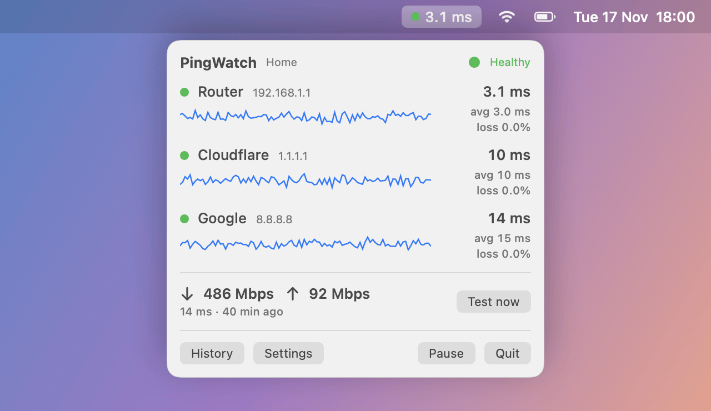
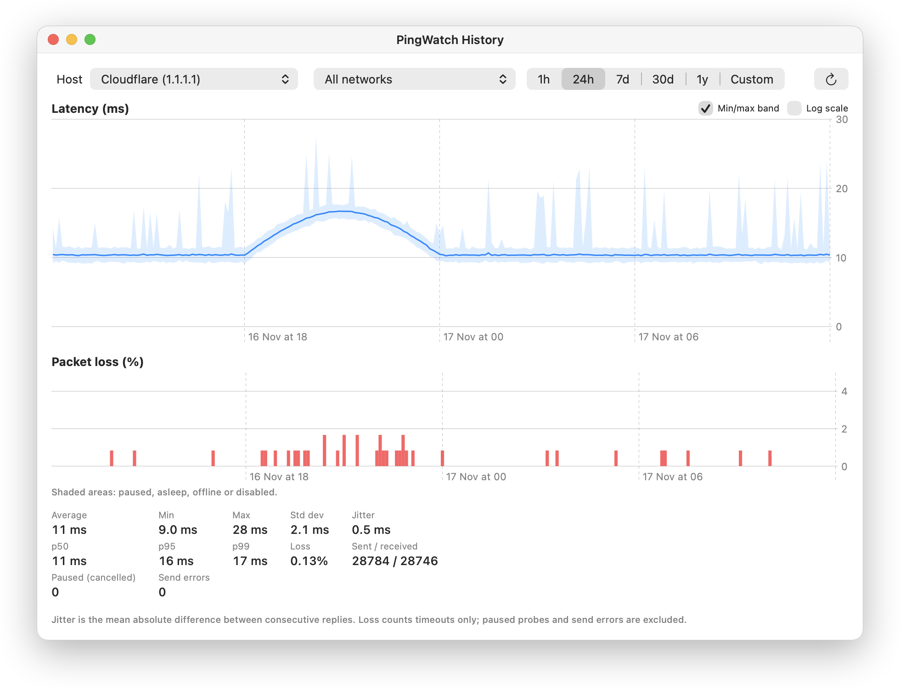
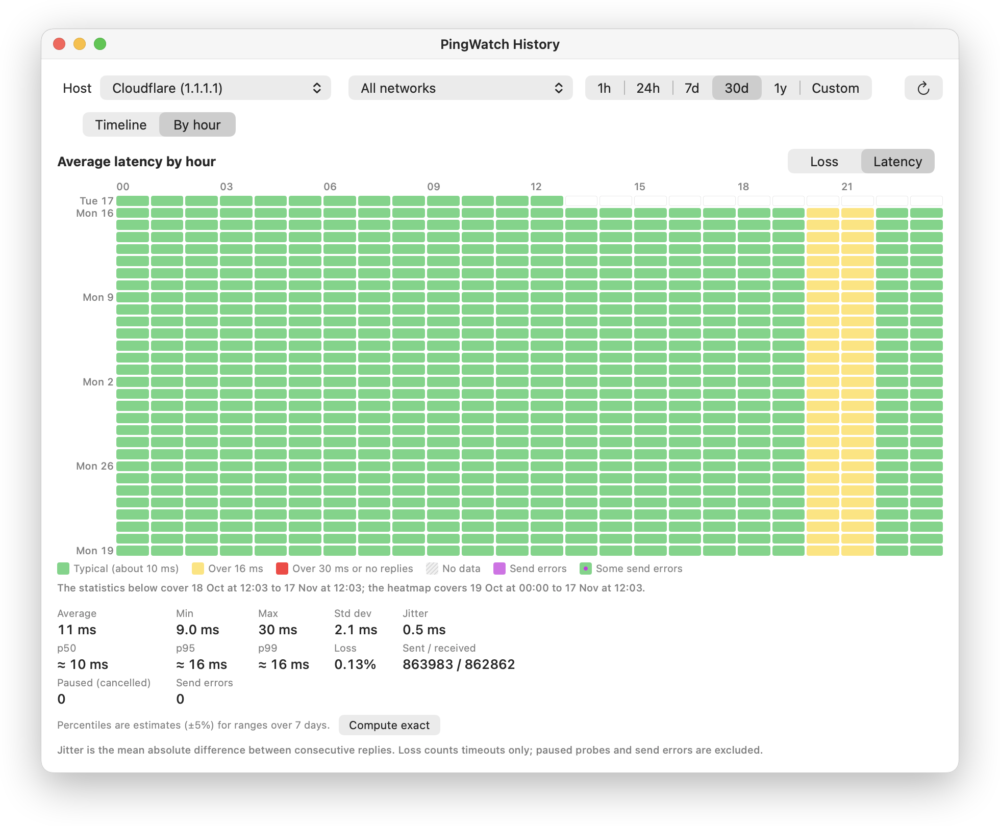
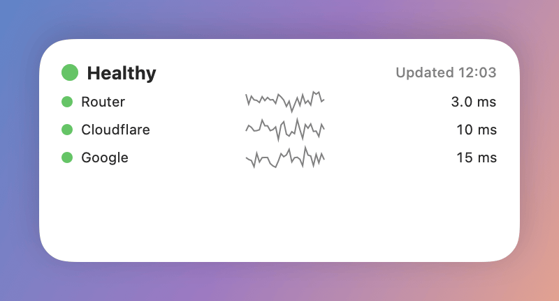
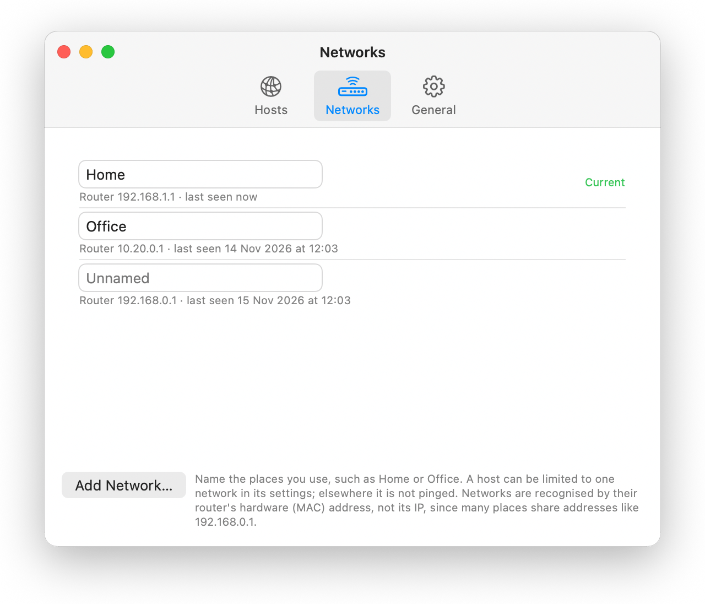

# PingWatch

A small menu bar app for the Mac that keeps pinging your router, your DNS
server and a couple of public servers, and keeps every result. When the
internet feels slow you can see whether it's the Wi-Fi, the router or your
provider, and since when.

## Features

- Latency, jitter and packet loss for each host, every few seconds.
- A green, amber or red dot in the menu bar, with the router's latency next
  to it.
- History for any range: charts, averages, exact percentiles, and a "By hour"
  view that shows which hours of the day are bad (pick one host and 7 or 30
  days).
- Works away from home. Router and DNS server follow whatever network you're
  on, and a host can be limited to one network (say, the mesh nodes at home).
- Speed test using Apple's networkQuality.
- A desktop widget.
- Pauses while the Mac sleeps or is offline, so that doesn't count as loss.
- Everything is stored locally in SQLite.

## Install

Requires macOS 15 or later.

1. Download `PingWatch-<version>.zip` from the
   [latest release](https://github.com/mathiasgrimm/pingwatch-releases/releases/latest).
2. Unzip it, move PingWatch to Applications and open it. It's signed and
   notarized.
3. Allow Local Network access when macOS asks. Without it PingWatch can't
   reach the router.

For the widget, right-click the desktop, choose Edit Widgets and add
PingWatch. macOS decides when widgets redraw, so it can lag a bit behind the
menu bar.

PingWatch checks for updates once a day and shows "Update available" in its
menu. You can turn that off in Settings > General.
